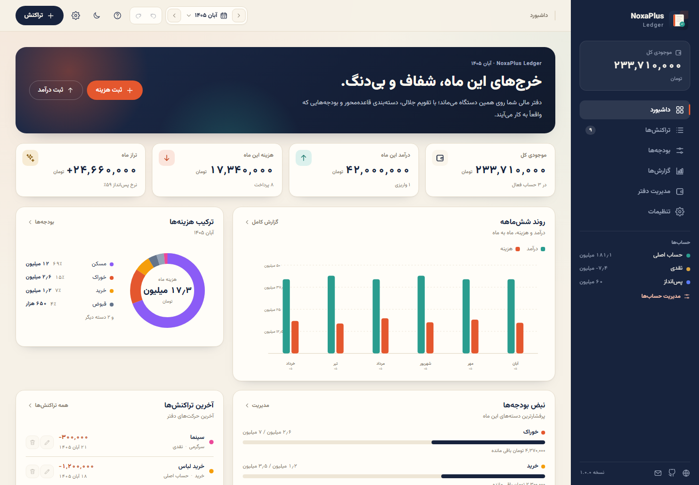
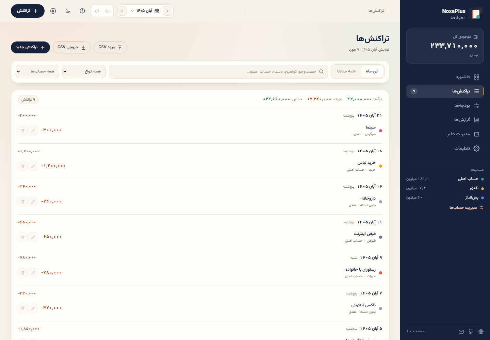
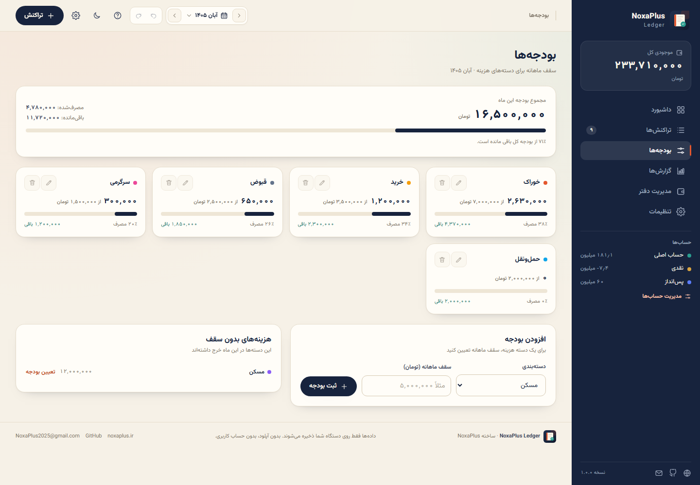
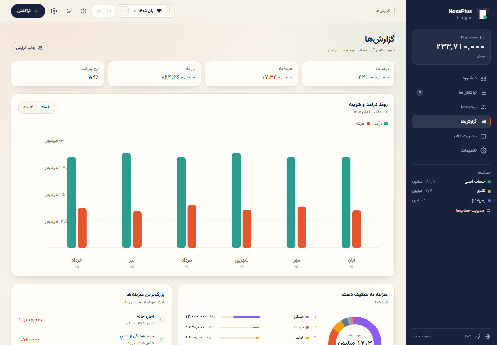
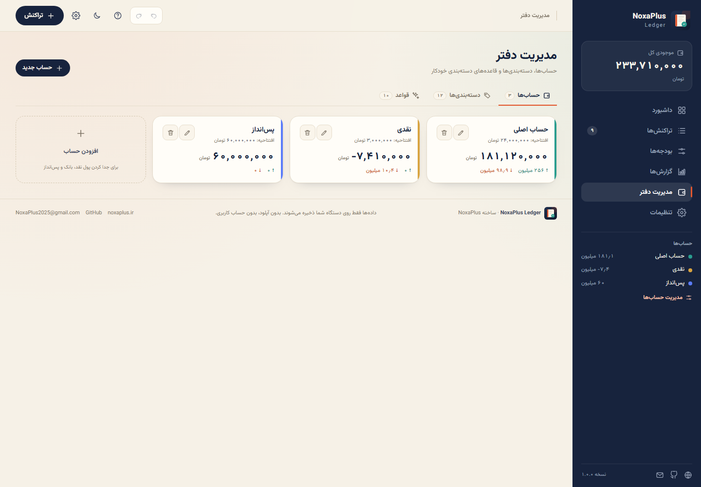
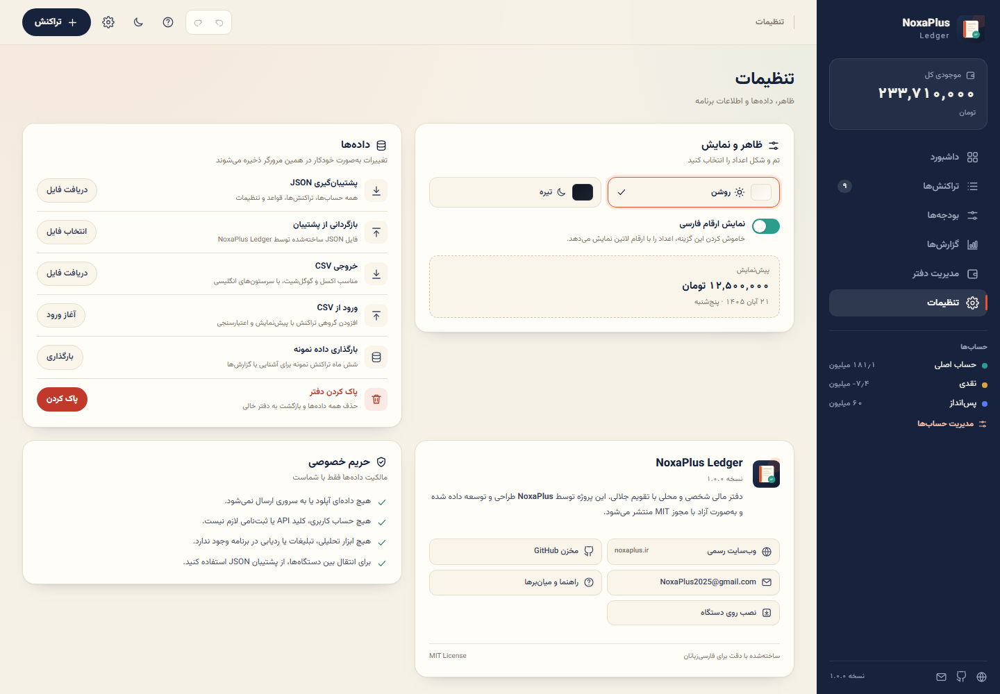
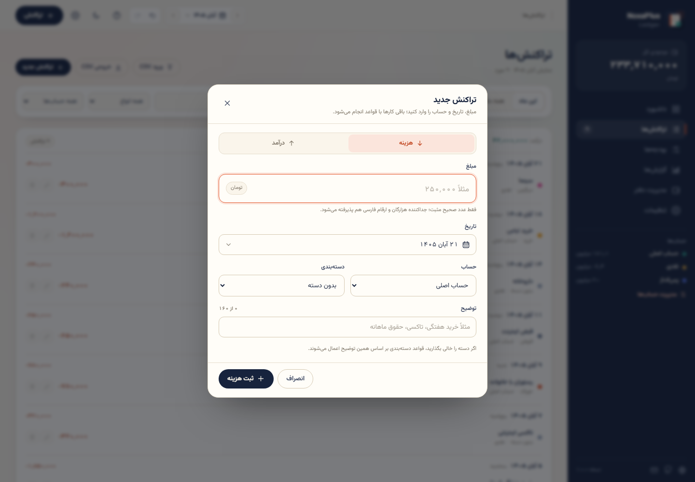
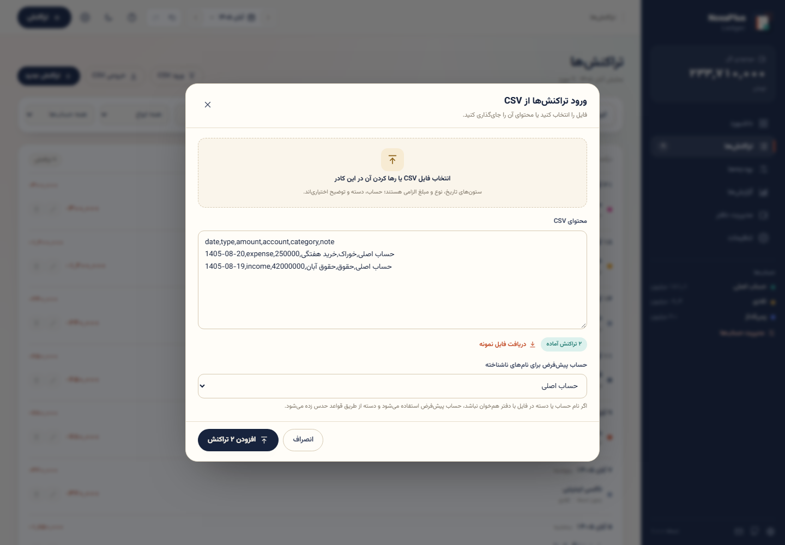
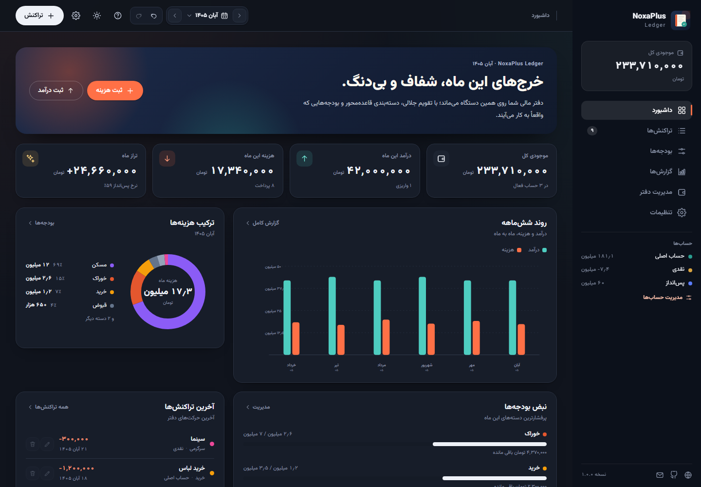
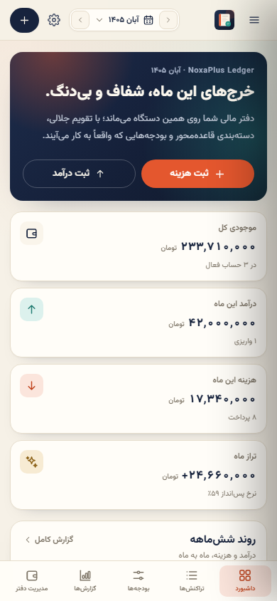

# NoxaPlus Ledger

**A local-first personal finance ledger for the Persian calendar.**

NoxaPlus Ledger is a free, open-source, installable web app for tracking income and expenses on a Jalali calendar. Everything runs in your browser: entries, budgets, categories and reports live in `localStorage`, and no byte ever leaves your device. There is no sign-up, no cloud, no analytics and no runtime network dependency.

Designed and developed by **[NoxaPlus](https://www.noxaplus.ir)**.

[](https://github.com/noxaplus-star/noxaplus-ledger/actions/workflows/ci.yml)
[](LICENSE)
[](#privacy-and-data-ownership)
[](#privacy-and-data-ownership)



## Table of contents

- [Why another finance app?](#why-another-finance-app)
- [Features](#features)
- [Screenshots](#screenshots)
- [Privacy and data ownership](#privacy-and-data-ownership)
- [Quick start](#quick-start)
- [How the ledger works](#how-the-ledger-works)
- [CSV import and export](#csv-import-and-export)
- [Backup and restore](#backup-and-restore)
- [Keyboard shortcuts](#keyboard-shortcuts)
- [Tech stack](#tech-stack)
- [Project structure](#project-structure)
- [Available scripts](#available-scripts)
- [Testing](#testing)
- [Deployment](#deployment)
- [Browser support](#browser-support)
- [Contributing](#contributing)
- [License](#license)

## Why another finance app?

Most budgeting tools assume a Gregorian month, an account on someone else's server, and a subscription. NoxaPlus Ledger makes three different bets:

1. **The calendar should match your life.** Months, weekdays, dates and reports are Jalali from the first byte. No conversion layer, no “January” in the middle of a Persian UI.
2. **Your finances are private by default.** The ledger is a static site. It works on a plane, in an air-gapped lab, or on a phone with no data connection.
3. **Fast entry beats elaborate setup.** Type an amount, pick a date, done. Rules can categorize recurring notes automatically, and budgets keep the month honest.

## Features

### Jalali-native by design
- Persian (Jalali) dates everywhere, with correct month lengths and leap years.
- A custom date picker with month-by-month navigation across years, plus a “today” shortcut.
- Six- and twelve-month trend charts labelled with Persian month names.
- Persian digits throughout the UI, with an optional Latin-digit mode for power users.

### Everyday ledger
- Record income and expenses in a couple of keystrokes; `N` opens a new entry.
- Numeric input accepts Persian and Latin digits plus thousand separators (`٬`, `,`).
- Search across notes, accounts, categories and amounts.
- Filter by type and account, or focus on a single month.
- Daily group headers show the net movement for each day.
- Edit and delete with confirmation; deleting shows an undo toast.
- Full undo/redo history for the last 40 changes, including budgets, accounts, categories and rules.

### Accounts, categories and rules
- Multiple accounts with opening balances and a live total balance.
- Separate income and expense categories, each with a color used in charts.
- Keyword rules that categorize transactions from their note automatically (for example “تاکسی” → transport).
- Apply rules retroactively to uncategorized rows.
- Guard rails: accounts or categories that are still referenced cannot be deleted, and removing an account or category asks for confirmation.

### Budgets
- A monthly cap per expense category.
- Overall budget progress plus per-category cards with spent, remaining and percentage.
- Clear over-budget warnings and a visual progress bar.
- Budgets reset per month, so last month's ceiling never leaks into this one.

### Reports
- Month totals for income, expense and net balance.
- Six- or twelve-month income/expense bar chart.
- Expense composition donut chart by category.
- Largest expenses of the month, ranked.
- Print-friendly layout for a clean PDF via the browser's print dialog.

### Import, export and restore
- CSV import with header detection, Persian/English column aliases, quoted fields and embedded newlines.
- Preview and validation before anything is written; invalid rows are reported with line numbers.
- One-click CSV export with an English header row, ready for Excel or Google Sheets.
- Versioned JSON backup download and restore, with schema validation before the ledger is replaced.
- One-click demo data (six months of realistic transactions) for exploring reports.
- Full ledger reset, with an undo window.

### A careful interface
- Responsive layout: sidebar on desktop, bottom navigation and a drawer on mobile.
- Light and dark themes, remembered across sessions.
- Accessible dialogs with focus handling, `Escape` to close and labelled icon buttons.
- Toast notifications, empty states and inline validation instead of dead ends.
- Installable PWA with an offline app shell and cached assets.

## Screenshots

| Dashboard | Transactions |
| --- | --- |
|  |  |

| Budgets | Reports |
| --- | --- |
|  |  |

| Manage | Settings |
| --- | --- |
|  |  |

| New transaction | Import CSV |
| --- | --- |
|  |  |

| Dark theme | Mobile |
| --- | --- |
|  |  |

## Privacy and data ownership

- **No backend.** The app is a static bundle. There is no API, database or server-side code in this repository.
- **No accounts or API keys.** Nothing to sign up for, nothing to leak.
- **No analytics, telemetry or third-party runtime requests.** Fonts are bundled, charts are hand-built SVG, and the service worker only caches same-origin files.
- **One storage location.** State is saved under the `noxaplus-ledger-state-v1` key in `localStorage`.
- **You own the exports.** CSV and JSON files are generated in the browser and downloaded directly.

Clearing site data or uninstalling the PWA removes the local ledger, so keep periodic JSON backups.

## Quick start

### Open directly — no installation

Download and extract the repository ZIP (or clone it), then double-click **`index.html` in the repository root**. The complete app, including JavaScript, CSS, and fonts, is embedded in this file. No Node.js, server, or internet connection is needed. `app/index.html` is the development source entry, not the standalone application.

Downloads work from disk; clipboard and PWA installation depend on browser support. Service workers only run over HTTP(S). Storage for `file://` URLs varies by browser and file location: export a JSON backup before moving the folder or switching browsers. After a build, `dist/index.html` is also directly usable.

### Develop from source

Requirements: **Node.js 20 or newer** (22 LTS recommended) and npm.

```bash
git clone https://github.com/noxaplus-star/noxaplus-ledger.git
cd noxaplus-ledger
npm install
npm run dev
```

Open the printed local URL (Vite defaults to <http://localhost:5173>). The first launch starts with an empty ledger and a short onboarding card; use **بارگذاری داده نمونه** in Settings to explore with demo data.

### Production build

```bash
npm run build
npm run preview
```

The self-contained static output is written to `dist/`, and the standalone root `index.html` is refreshed automatically. It can be hosted on GitHub Pages, Netlify, Cloudflare Pages or any static file server.

## How the ledger works

### Dates
Dates are stored as Latin-digit Jalali keys in `YYYY-MM-DD` form (for example `1405-08-21`). The UI renders Persian digits, but the key stays stable and sortable. Conversion utilities cover month lengths, leap years, weekday names and month arithmetic.

### Money
Amounts are positive Toman integers. The transaction type determines direction, so there are no floating-point surprises and no negative stored values. Formatting adds Persian thousands separators and compact units (`هزار`, `میلیون`, `میلیارد`), with explicit LTR isolation for signed summary values inside the RTL layout.

### State and history
The reducer-style ledger hook keeps `present`, `past` and `future` snapshots. Every mutation pushes onto a 40-entry history stack, persists synchronously, and can be undone from the UI or with `Ctrl/Cmd + Z`. Persistence failures surface as a toast rather than silently losing data.

### Validation
Imported backups pass through a strict schema validator: version, account/category/rule references, date formats, positive integers and settings are all checked before the current ledger is replaced. Invalid files are rejected without touching existing data.

## CSV import and export

Export always writes this header:

```csv
date,type,amount,account,category,note
1405-08-21,expense,300000,حساب اصلی,خوراک,خرید هفتگی
1405-08-20,income,42000000,حساب اصلی,حقوق,حقوق ماهانه
```

Import is deliberately forgiving about headers. These aliases are recognized:

| Field | Accepted headers |
| --- | --- |
| `date` | `date`, `تاریخ` |
| `type` | `type`, `نوع` |
| `amount` | `amount`, `مبلغ` |
| `account` | `account`, `حساب` |
| `category` | `category`, `دسته`, `دسته‌بندی` |
| `note` | `note`, `توضیح`, `شرح` |

Rules for import:

- Dates must be Jalali `YYYY-MM-DD` (Persian digits are normalized).
- `type` accepts `income` / `expense` and `درآمد` / `هزینه`.
- Amounts accept Persian or Latin digits and separators.
- Rows without an account are assigned to the selected fallback account.
- Unknown category names are reported and left uncategorized; the import still succeeds.
- Quoted fields, commas inside quotes and embedded newlines are supported.
- Nothing is written until you confirm the preview.

## Backup and restore

A JSON backup contains the entire ledger plus a small envelope:

```json
{
  "app": "NoxaPlus Ledger",
  "version": 1,
  "exportedAt": "2026-11-12T10:00:00.000Z",
  "state": {
    "version": 1,
    "accounts": [],
    "categories": [],
    "rules": [],
    "transactions": [],
    "budgets": [],
    "settings": { "theme": "light", "persianDigits": true }
  }
}
```

Restore validates the envelope and state, asks for confirmation, and then replaces the current ledger. Keep the file private: it contains every note and amount in your ledger in plain text.

## Keyboard shortcuts

| Shortcut | Action |
| --- | --- |
| `N` | New transaction |
| `?` | Open the in-app help |
| `Ctrl/Cmd + Z` | Undo |
| `Ctrl/Cmd + Shift + Z` or `Ctrl/Cmd + Y` | Redo |
| `Escape` | Close the open dialog or mobile drawer |

Shortcuts are ignored while typing in an input, textarea or select.

## Tech stack

- **React 19** with function components and hooks
- **TypeScript 7** in strict mode
- **Vite 8** for development, bundling and asset handling
- **Vitest 5** for the core test suite
- **Hand-written CSS** design system, no UI framework
- **Vazirmatn** variable font, bundled locally
- **Hand-built SVG charts** and a custom Jalali date picker
- **Service worker + web manifest** for offline installability

The app deliberately avoids chart libraries, date libraries and state-management packages. The core modules are framework-free and unit-tested in a Node environment.

## Project structure

```text
.
├── public/                 # Manifest, service worker, icons, social image
├── docs/screenshots/       # Screenshots used by this README
├── scripts/                # Icon generation
├── src/
│   ├── components/         # Dialogs, charts, pickers and shared UI
│   ├── core/               # Jalali, money, rules, reports, CSV, storage
│   ├── hooks/              # Ledger state, toasts, install prompt
│   ├── pages/              # Dashboard, Transactions, Budgets, Reports, Manage, Settings
│   ├── App.tsx             # Shell, routing and global shortcuts
│   ├── format.ts           # Persian formatting facade
│   └── styles.css          # Design system, layouts, print and dark theme
├── index.html
├── vite.config.ts
└── package.json
```

The `src/core` directory is the trustworthy part: pure functions with no React and no browser globals (storage accepts an injected `Storage`-like object, which makes it testable). UI components consume those functions through a small formatter facade.

## Available scripts

| Script | Description |
| --- | --- |
| `npm run dev` | Start the Vite dev server |
| `npm run build` | Typecheck and build the production bundle |
| `npm run preview` | Serve the built bundle locally |
| `npm run typecheck` | Run TypeScript without emitting files |
| `npm test` | Run the Vitest suite once |
| `npm run test:watch` | Run tests in watch mode |
| `npm run icons` | Regenerate PNG icons from the SVG mark |

## Testing

```bash
npm run typecheck
npm test
npm run build
```

The suite covers 88 assertions across seven files:

- `money.test.ts` — parsing Persian/Latin digits, separators, compact formatting, integer safety.
- `jalali.test.ts` — month lengths, leap years, weekday math, key round-trips.
- `rules.test.ts` — keyword matching, type scoping, retroactive application.
- `reports.test.ts` — monthly totals, category breakdowns, ranges, averages.
- `csv.test.ts` — alias detection, quoted fields, newlines, validation errors.
- `storage.test.ts` — schema validation, corruption handling, backup envelopes.
- `sample.test.ts` — deterministic demo data across six months.

The interface was additionally exercised end to end in a headless browser: creating, editing and deleting transactions, Persian amount parsing, date picking, CSV import and export, JSON backup/restore, account/category/rule management, budgets, reports, reset/undo, keyboard shortcuts and the mobile navigation. Screenshots in `docs/screenshots` come from those runs.

## Deployment

The repository ships two GitHub Actions workflows:

- `.github/workflows/ci.yml` — typecheck, tests and build on every push and pull request.
- `.github/workflows/deploy.yml` — build and publish `dist/` to GitHub Pages on pushes to `main`.

To publish your own copy:

1. Push the repository to GitHub.
2. In **Settings → Pages**, set the source to **GitHub Actions**.
3. Push to `main` and wait for the deploy workflow.

Vite is configured with `base: './'`, so the same bundle works from a project path such as `/noxaplus-ledger/` without rewriting asset URLs. The service worker registers only in production builds.

Live demo: <https://noxaplus-star.github.io/noxaplus-ledger/>

## Browser support

NoxaPlus Ledger targets current evergreen browsers: Chrome/Edge 111+, Firefox 111+, Safari 16.4+ and their mobile counterparts. Installability and offline caching require a secure context (HTTPS or `localhost`). The app degrades gracefully when service workers are unavailable; the ledger itself only needs `localStorage`.

## Contributing

Issues and pull requests are welcome. Please read [CONTRIBUTING.md](CONTRIBUTING.md) before opening a PR, and follow the [Code of Conduct](CODE_OF_CONDUCT.md). For security reports, use the process in [SECURITY.md](SECURITY.md) rather than a public issue.

## License

Released under the [MIT License](LICENSE). You may use, modify and redistribute it, including commercially, as long as the copyright notice is preserved.

---

Built with care by **NoxaPlus** · [www.noxaplus.ir](https://www.noxaplus.ir) · [NoxaPlus2025@gmail.com](mailto:NoxaPlus2025@gmail.com)
